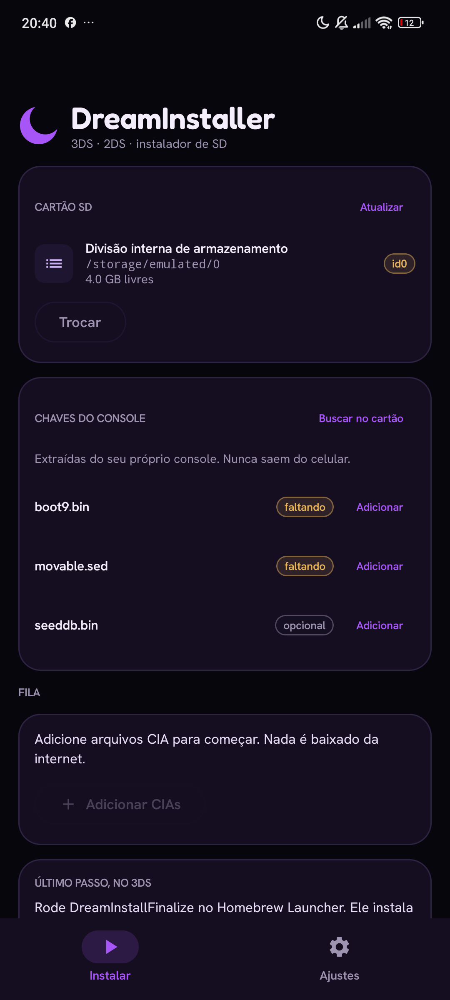
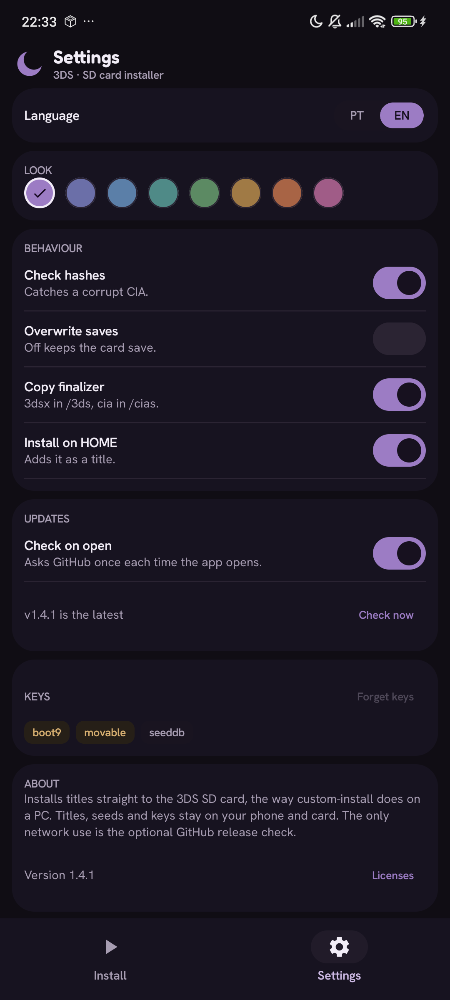

# DreamInstall

**English** | [Português](README.pt-BR.md)

Android installer for Nintendo 3DS titles. It writes games straight to the SD card, the same
way [custom-install](https://github.com/ihaveamac/custom-install) does on a PC.

The app reads the `.cia`, writes `.app`/`.tmd` to the card, builds the `cmd`, updates `title.db`
with `save3ds`, and leaves a `cifinish.bin` for the last step on the console. It is not a network
install, and it does not go through FBI.

## About this project

This repository is derived from
[ihaveamac/custom-install](https://github.com/ihaveamac/custom-install). The original Python code
stays at the root and the Android version lives in [`android/`](android/). The original README is
kept at [docs/custom-install-README.md](docs/custom-install-README.md).

```
android/        Android app (Kotlin + Compose) — DreamInstall
3ds/            DreamInstallFinalize finalizer (C, libctru + citro2d)
custominstall/  original Python tool, for PC
finalize/       original homebrew that installs the ticket and seed on the 3DS
extras/         upstream helper scripts
docs/           original custom-install README
```

The finalizer lives in `3ds/` and is copied to the card by the app.

| Home | Settings |
| --- | --- |
|  |  |

## Contents

- [How to use](#how-to-use)
  - [1. Install the app](#1-install-the-app)
  - [2. Prepare the keys](#2-prepare-the-keys)
  - [3. Connect the SD card](#3-connect-the-sd-card)
  - [4. Install the titles](#4-install-the-titles)
  - [5. Finish on the 3DS](#5-finish-on-the-3ds)
- [App settings](#app-settings)
- [Troubleshooting](#troubleshooting)
- [Limits](#limits)
- [Building from scratch](#building-from-scratch)
- [How it works](#how-it-works)
- [Tests](#tests)
- [Privacy and legality](#privacy-and-legality)
- [Credits and licenses](#credits-and-licenses)
- [Roadmap](#roadmap)

## How to use

### 1. Install the app

Download the APK from
[Releases](https://github.com/eduhbarb/DreamInstall/releases/latest) and install it on the phone.
The current file is `DreamInstall-1.4.3.apk`.

- Android 11 or newer, arm64.
- Official APKs are signed with the DreamInstall release key; sideload build, not from the Play
  Store.
- On MIUI/HyperOS, allow **Install via USB** or open the APK from the file manager. If the system
  blocks a USB install, copy the APK to the phone and tap it there.

**Signing change in 1.4.3:** releases up to 1.4.2 used a debug key, so Android cannot update them in
place. Uninstall 1.4.2 before installing 1.4.3; this deletes the app's keys and queue.

On the first launch the app asks for **All files access**. It needs that to write to real card
paths (`/storage/XXXX-XXXX`). Without it the card does not show up. The app only uses the network
to check GitHub for new releases; see [Privacy](#privacy-and-legality).

### 2. Prepare the keys

You need three files dumped from **your own console**:

| File | Required | Size | What it is for |
| --- | --- | --- | --- |
| `boot9.bin` | yes | **64 KiB** (0x10000) | derives the crypto keys |
| `movable.sed` | yes | 0x120 | derives the SD key and the console `id0` |
| `seeddb.bin` | recommended | varies | seeds for games from 2015 on |

How to dump them: use GodMode9 on the 3DS. `boot9.bin` must be the full 64 KiB dump; a 32 KiB
`boot9_prot.bin` does not work. `seeddb.bin` can come from
[seedconv](https://github.com/ihaveamac/3DS-rom-tools/wiki/SeedDB-list) or from GodMode9,
depending on the method you already use.

In the app, tap **Add** next to each file. The keys are copied to the app's private storage and
never leave the device. **Forget keys** in Settings deletes them.

As soon as you pick the SD card, the app looks for the keys on its own, in the same places as the
custom-install PC GUI:

```
SD/gm9/out/boot9.bin
SD/gm9/out/movable.sed
SD/gm9/out/seeddb.bin
SD/boot9strap/<file>
SD/<file>
```

Whatever is missing is copied and loaded automatically. If you already have keys in the app, they
are not replaced; use **Scan card** in the **Console keys** card to force the card copies. The
scan also accepts different upper/lower case in the file names.

The app does not include keys, tickets or games. Use only `.cia` files you have the right to use.

### 3. Connect the SD card

Use a USB-C/OTG reader. The phone slot usually takes only a storage microSD, not the 3DS card.

1. Turn the 3DS off and take the card out.
2. Connect the card to the phone.
3. The app selects the card automatically: it looks for a removable volume with a `Nintendo 3DS`
   folder and prefers the one that matches the `id0` from your `movable.sed`. Internal storage is
   never picked automatically.
4. To use another volume, tap **Change** in the **SD card** card and pick one; the choice is kept
   while that volume is mounted.
5. On selection the app already looks for `boot9.bin`, `movable.sed` and `seeddb.bin` on the card.

If **id0 missing** appears, the card was not used on this console or the `movable.sed` is from
another device. Put the card in the 3DS once, turn it on and off, and try again.

### 4. Install the titles

1. Tap **Add CIAs** and pick one or more files.
2. Check name, icon, title, version and size in the queue.
3. Tap **Install**.

Writing runs in a foreground service with a notification, per-title progress, speed and time left.
You can leave the app; the notification stays. Do not remove the card during an install.

What the app does:

- Checks the SHA-256 of every content (if the option is on).
- Writes to a temporary folder on the card and only then renames to `title/<high>/<low>`.
- Backs up `title.db` and `import.db` to `/ci-backup/<date-time>/` before touching them.
- Imports `title.db` after each title, so an interruption does not lose the previous ones.
- Copies `DreamInstallFinalize.3dsx` to `/3ds` and `DreamInstallFinalize.cia` to `/cias` when they
  are missing or outdated.
- Warns when the card gets close to the HOME Menu limit of 300 icons.

Cancel stops after the current title, without corrupting the queue.

### 5. Finish on the 3DS

1. Eject the card from the phone (or unplug the reader safely).
2. Put the card in the 3DS.
3. Open the **Homebrew Launcher** and run **DreamInstallFinalize**.

The app leaves the finalizer on the card automatically: `3dsx` in `/3ds` and `.cia` in `/cias`. It
only rewrites a file when it is missing or different from the current build. If the finalizer is
not installed on the console yet, the app also installs its CIA as a title and puts its ticket in
the next `cifinish.bin`; after the first 3dsx run it shows up on the HOME Menu. This can be turned
off in **Settings → Install DreamInstallFinalize on the HOME Menu**.

DreamInstallFinalize does the same job as `custom-install-finalize`: installs the ticket and the
seed on the console. At the end it shows the finalized titles, the ones that were already there and
the ones that failed, and asks for **START** to return to the menu. It does not list itself, only
the games.

If you prefer to install the CIA by hand, it is also at `/cias/DreamInstallFinalize.cia`; the 3dsx
is still the simplest way to run it.

The ticket lives in the NAND `ticket.db`. No Android app can write it, so this step on the 3DS
stays mandatory.

## App settings

- **Language**: PT/EN. On the first launch any Portuguese phone locale keeps Portuguese, anything
  else uses English. The choice is saved and can be changed at any time.
- **Accent**: eight colours; the whole theme is recalculated from the chosen colour, like DreamFTP.
- **Check content hashes**: on by default. Catches a corrupt CIA before it reaches the card.
- **Overwrite existing saves**: off by default; keeps the save already on the card.
- **Copy DreamInstallFinalize automatically**: on by default; keeps the 3dsx and the cia on the
  card.
- **Install DreamInstallFinalize on the HOME Menu**: on by default; installs the CIA as a title if
  it is not in `title.db` yet. The ticket goes in on the next finalize.
- **Check on open**: on by default; asks GitHub once each time the app opens. Turn it off to check
  only when you press **Check now**.
- **Forget keys**: deletes `boot9.bin`, `movable.sed` and `seeddb.bin` from the app.

When a newer release exists, the app offers **Download**, **Ignore** (skips that version in the
automatic check) and **GitHub**.

## Troubleshooting

| Symptom | Likely cause | What to do |
| --- | --- | --- |
| Card does not appear | file permission denied | grant All files access |
| `id0 ... does not exist` | card from another console or wrong `movable.sed` | use the card on the console once and check the key |
| `boot9.bin must be 0x10000 bytes` | partial 32 KiB dump | use the full 64 KiB dump |
| `seed missing` | 2015+ game without `seeddb.bin` | add `seeddb.bin` and install again |
| `hash mismatch` | corrupt CIA | download/copy the file again |
| Install stops halfway | app killed by the system | the install runs in the foreground; keep the notification alive |
| Game installed but still a gift | ticket not installed | run `DreamInstallFinalize` on the 3DS |
| Game does not show up | HOME Menu full or ticket missing | run the finalizer; delete titles to stay under 300 |
| DreamInstallFinalize is not on the HOME Menu | ticket not installed yet | run the 3dsx once; the app already put the title on the card |
| Invalid CIFINISH or zeroed cifinish.bin | an old write lost the content | use app 1.2.1 or newer and install again |
| `title.db corrupted` | card problem or interruption | restore `/ci-backup/<date>/title.db` and delete `cifinish.bin` |
| System cancels the install on MIUI | install restriction | open the APK from the file manager or allow Install via USB |
| Update check fails | no network or GitHub down | ignore it; the app works offline |

## Limits

- `arm64-v8a` only.
- Android 11+.
- Sideload: uses `MANAGE_EXTERNAL_STORAGE`, so it cannot be published on the Play Store.
- DSiWare (`00048*`) is not supported, same as custom-install.
- New 3DS-only titles with extra crypto (slots 0x18/0x1B) may lack a name or icon; the install
  itself does not depend on it.
- The app never downloads games or keys. Its only network use is the GitHub release check.

## Building from scratch

### Requirements

- JDK 17
- Android SDK 36 (platform + build-tools)
- Gradle 8.13 or the included wrapper
- Rust with the `aarch64-linux-android` target and the Android NDK **only** to rebuild the native
  binary (the `.so` is already in the repository)

### Android Studio

1. Open the project folder.
2. Let Android Studio download Gradle and the SDK.
3. Run the `app` configuration.

### Command line

```powershell
$env:JAVA_HOME = "C:\path\to\jdk-17"
$env:ANDROID_HOME = "$env:LOCALAPPDATA\Android\Sdk"

cd android
.\gradlew.bat :app:assembleDebug
```

The APK lands in `android/app/build/outputs/apk/debug/app-debug.apk`.

Release build. Official releases use a DreamInstall release key read from environment variables;
without them Gradle falls back to the local debug key:

```powershell
$env:DREAMINSTALL_KEYSTORE = "C:\path\to\dreaminstall-release.jks"
$env:DREAMINSTALL_KEYSTORE_PASSWORD = "..."
$env:DREAMINSTALL_KEY_ALIAS = "dreaminstall"
$env:DREAMINSTALL_KEY_PASSWORD = "..."

cd android
.\gradlew.bat :app:assembleRelease
```

The APK lands in `android/app/build/outputs/apk/release/app-release.apk`. Never commit the keystore
or the passwords.

### Rebuilding the 3DS finalizer

The source is in `3ds/DreamInstallFinalize` (C, libctru + citro2d). It needs devkitPro with
`3ds-dev`, makerom and bannertool.

```sh
cd 3ds/DreamInstallFinalize
make
bannertool makebanner -i meta/banner.png -a meta/audio.wav -o banner.bin
makerom -f cia -o DreamInstallFinalize.cia -target t -elf DreamInstallFinalize.elf \
  -rsf meta/DreamInstallFinalize.rsf -icon DreamInstallFinalize.smdh -banner banner.bin -exefslogo
```

The `.github/workflows/3ds.yml` workflow builds it in the `devkitpro/devkitarm` container and
publishes `DreamInstallFinalize.3dsx` and `DreamInstallFinalize.cia` as artifacts.

### Rebuilding `save3ds`

The binary used to edit `title.db` is `save3ds` without FUSE, compiled for Android.

```powershell
git clone https://github.com/wwylele/save3ds.git C:\src\save3ds
cd C:\src\save3ds
git checkout (Get-Content "android\native\save3ds-commit.txt")

rustup target add aarch64-linux-android
cd android
.\native\build-save3ds.ps1 -Source "C:\src\save3ds" -Ndk "C:\Android\Sdk\ndk\28.2.13676358"
```

The script builds with `--no-default-features` (no FUSE) and copies the result to
`android/app/src/main/jniLibs/arm64-v8a/libsave3ds.so`.

### Structure

```
android/app/src/main/java/dev/oni/dreaminstall/
├── AppViewModel.kt         UI state, queue, keys, volumes, updates
├── DreamInstallApp.kt      applies the saved language on start
├── Language.kt             per-app locale, first-run detection
├── MainActivity.kt         Compose entry point
├── core/
│   ├── Crypto.kt           AES-ECB/CTR, CMAC, keygen, path IV
│   ├── Keys.kt             boot9/movable/seeddb, common key, id0
│   ├── Cia.kt              CIA/TMD/NCCH parser, metadata, icon
│   ├── Installer.kt        write pipeline, cmd, title info, cifinish
│   ├── Save3ds.kt          native binary exec
│   ├── Storage.kt          volumes, id0/id1, space, backup, card choice
│   ├── Updates.kt          GitHub release check, version compare
│   └── Queue.kt            persisted queue, install state
├── service/InstallService.kt   foreground, notification, progress
└── ui/                     screens, components and theme
```

## How it works

The flow is the same as custom-install, with the database work delegated to `save3ds`:

1. **Keys**: `sd_key = keygen(KeyX[0x34], movable[0x110..0x120])` and `id0 = SHA-256(keyY)` with
   the 32-bit words reversed. The full boot9 keyblob is at `0xD860`.
2. **CIA**: the ticket decrypts the titlekey; the TMD is validated (info record hashes) and the
   active contents come from the archive header (MSB-first bits).
3. **Content**: each section is decrypted with AES-CBC and the titlekey, checked with SHA-256, and
   rewritten with AES-CTR using the path IV (`SHA-256(path UTF-16LE + NUL)`, big-endian).
4. **Metadata**: exheader, ExeFS and icon go through a second NCCH crypto layer (signature KeyY +
   boot9 KeyX, per-partition/section counter). The extdata id comes from the exheader.
5. **cmd**: for each content, CMAC over `SHA-256(header[0x100..0x200] + index + id)`.
6. **Title**: files go to `ci-install-temp-*` and are renamed to `title/<high>/<low>`; `title.db`
   is extracted, the 0x80-byte entry is written, and the database is imported back.
7. **cifinish**: v3 record with title and seed, read by `custom-install-finalize` on the 3DS.

## Tests

```powershell
cd android
.\gradlew.bat :app:testDebugUnitTest          # vectors, parser, versions, locale, card choice
.\gradlew.bat :app:connectedDebugAndroidTest  # installs fixtures on the device
```

- **Golden vectors**: generated with `pyctr`/`pycryptodomex` from a synthetic boot9. They cover
  the keyblob, keygen, path IV, CTR (including broken blocks), CMAC, titlekey decryption, cifinish
  and the NCCH counter.
- **Fixtures**: two synthetic CIAs (one with a seed) with encrypted exheader/ExeFS.
- **E2E**: the app installs the fixtures on the device. The generated tree is compared with the
  custom-install PC output: files, `title.db` and `cifinish.bin` match byte for byte (the only
  random field in the database entry is ignored).
- **Formatter**: the `3ds` workflow builds the 3dsx and the CIA. The Android E2E test checks that
  both files arrive in `/3ds` and `/cias` and that `/dreamfinalize-names.txt` is written.

## Privacy and legality

- Keys and CIAs stay on the device; the app sends nothing about you.
- The only network use is the optional GitHub release check (`api.github.com`, repository
  `eduhbarb/DreamInstall`). It has no telemetry and no analytics.
- The database backup stays on the card itself, in `/ci-backup`.
- The app does not distribute keys, tickets, seeds or games.
- Use only content you have the right to use. This project is not affiliated with Nintendo.

## Credits and licenses

- Install flow: port of [custom-install](https://github.com/ihaveamac/custom-install) (MIT, Ian
  Burgwin).
- Title database: [save3ds](https://github.com/wwylele/save3ds) (MIT or Apache-2.0, Weiyi Wang).
- Crypto and format reference: [pyctr](https://github.com/ihaveamac/pyctr) (MIT, Ian Burgwin).
- Fonts: [Fredoka](https://github.com/hafontia/Fredoka-One) and
  [Hanken Grotesk](https://github.com/marcologous/hanken-grotesk), SIL OFL 1.1.
- Look: inspired by [DreamFTP](https://github.com/Synaelle/DreamFTP) (AGPL-3.0).
- 3DS finalizer: based on
  [custom-install-finalize](https://github.com/ihaveamac/custom-install/tree/python-package/finalize)
  (MIT, Ian Burgwin).

The app code is MIT (`android/LICENSE`). The original custom-install keeps the MIT license in
`LICENSE.md`. Full license texts are in `android/app/src/main/assets/licenses` and on the Licenses
screen.

## Roadmap

- [x] CIA install straight to the SD card from Android
- [x] Queue, progress, cancel, database backup
- [x] Theme with accents, pt-BR/en, automatic SD choice, GitHub update check
- [x] Own 3DS finalizer (DreamInstallFinalize, 3dsx + cia)
- [ ] Support for other ABIs
