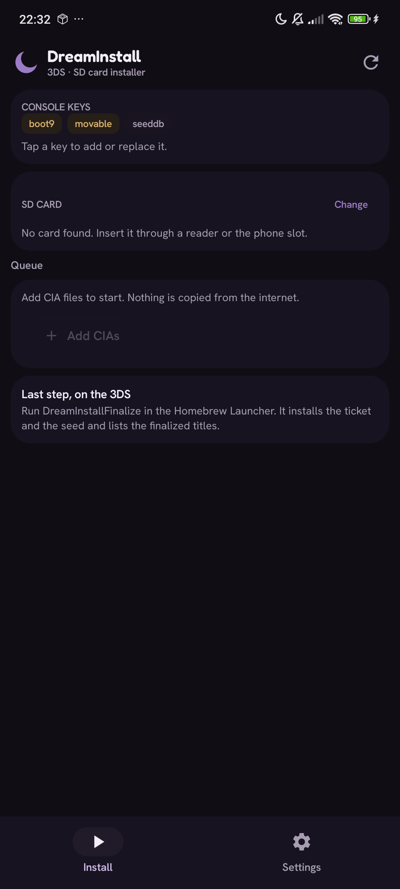
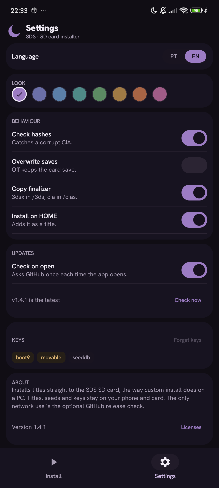

# DreamInstall

[English](README.md) | **Português**

Instalador de títulos do Nintendo 3DS para Android. Grava os jogos direto no cartão SD, do mesmo
jeito que o [custom-install](https://github.com/ihaveamac/custom-install) faz no PC.

O app lê o `.cia`, escreve `.app`/`.tmd` no cartão, gera o `cmd`, atualiza o `title.db` com o
`save3ds` e deixa o `cifinish.bin` para o último passo no console. Não é instalação por rede e não
passa pelo FBI.

## Sobre este fork

Este repositório é um fork de
[ihaveamac/custom-install](https://github.com/ihaveamac/custom-install). O código original em Python
continua na raiz e a versão Android fica em [`android/`](android/). O README original está
preservado em [docs/custom-install-README.md](docs/custom-install-README.md).

```
android/        app Android (Kotlin + Compose) — o DreamInstall
3ds/            finalizador DreamInstallFinalize (C, libctru + citro2d)
custominstall/  ferramenta original em Python, para PC
finalize/       homebrew original que instala ticket e seed no 3DS
extras/         scripts auxiliares do upstream
docs/           README original do custom-install
```

O finalizador próprio fica em `3ds/` e é copiado para o cartão pelo app.

| Tela principal | Ajustes |
| --- | --- |
|  |  |

## Sumário

- [Como usar](#como-usar)
  - [1. Instalar o app](#1-instalar-o-app)
  - [2. Preparar as chaves](#2-preparar-as-chaves)
  - [3. Conectar o cartão SD](#3-conectar-o-cartão-sd)
  - [4. Instalar os títulos](#4-instalar-os-títulos)
  - [5. Finalizar no 3DS](#5-finalizar-no-3ds)
- [Ajustes do app](#ajustes-do-app)
- [Solução de problemas](#solução-de-problemas)
- [Limites](#limites)
- [Buildar do zero](#buildar-do-zero)
- [Como funciona](#como-funciona)
- [Testes](#testes)
- [Privacidade e legalidade](#privacidade-e-legalidade)
- [Créditos e licenças](#créditos-e-licenças)
- [Roadmap](#roadmap)

## Como usar

### 1. Instalar o app

Baixe o APK em
[Releases](https://github.com/eduhbarb/DreamInstall/releases/latest) e instale no celular. O
arquivo da versão atual é `DreamInstall-1.4.1.apk`.

- Android 11 ou mais novo, arm64.
- O APK é assinado com uma chave de desenvolvimento, então não vem da Play Store.
- Em MIUI/HyperOS, libere **Instalar via USB** ou abra o APK pelo gerenciador de arquivos. Se o
  sistema bloquear a instalação por USB, copie o APK para o celular e toque nele.

Na primeira abertura, o app pede **Acesso a todos os arquivos**. Isso é necessário porque ele grava
em caminhos reais do cartão (`/storage/XXXX-XXXX`). Sem essa permissão o cartão não aparece. O app
só usa a rede para procurar releases novas no GitHub; veja [Privacidade](#privacidade-e-legalidade).

### 2. Preparar as chaves

Você precisa de três arquivos extraídos do **seu próprio console**:

| Arquivo | Obrigatório | Tamanho | Para que serve |
| --- | --- | --- | --- |
| `boot9.bin` | sim | **64 KiB** (0x10000) | deriva as chaves de crypto |
| `movable.sed` | sim | 0x120 | deriva a chave SD e o `id0` do console |
| `seeddb.bin` | recomendado | variável | seeds dos jogos de 2015 em diante |

Como extrair: use o GodMode9 no 3DS. O `boot9.bin` precisa ser o dump completo de 64 KiB; um
`boot9_prot.bin` de 32 KiB não funciona. O `seeddb.bin` pode ser obtido com o
[seedconv](https://github.com/ihaveamac/3DS-rom-tools/wiki/SeedDB-list) ou com o próprio GodMode9,
dependendo do método que você já usa.

No app, toque em **Adicionar** ao lado de cada arquivo. As chaves são copiadas para o armazenamento
privado do app e nunca saem do aparelho. O botão **Esquecer chaves** em Ajustes apaga tudo.

Assim que você escolhe o cartão SD, o app procura as chaves sozinho, nos mesmos lugares do GUI do
custom-install no PC:

```
SD/gm9/out/boot9.bin
SD/gm9/out/movable.sed
SD/gm9/out/seeddb.bin
SD/boot9strap/<arquivo>
SD/<arquivo>
```

O que faltar é copiado e carregado automaticamente. Se você já tem chaves no app, elas não são
substituídas; use **Buscar no cartão** no card **Chaves do console** para forçar a troca pelas do
cartão. A busca também aceita maiúsculas/minúsculas diferentes nos nomes.

O app não inclui chaves, tickets nem jogos. Use apenas `.cia` que você tem o direito de usar.

### 3. Conectar o cartão SD

Use um leitor USB-C/OTG. O slot do celular normalmente aceita só microSD de armazenamento, não o
cartão do 3DS.

1. Desligue o 3DS e tire o cartão.
2. Conecte o cartão no celular.
3. O app seleciona o cartão automaticamente: procura um volume removível com a pasta
   `Nintendo 3DS` e prefere o que combina com o `id0` do seu `movable.sed`. O armazenamento interno
   nunca é escolhido sozinho.
4. Para usar outro volume, toque em **Trocar** no card **Cartão SD** e escolha um; a escolha fica
   salva enquanto esse volume estiver montado.
5. Ao selecionar, o app já procura `boot9.bin`, `movable.sed` e `seeddb.bin` no cartão.

Se aparecer **id0 ausente**, o cartão não foi usado nesse console ou o `movable.sed` é de outro
aparelho. Coloque o cartão no 3DS uma vez, ligue e desligue, e tente de novo.

### 4. Instalar os títulos

1. Toque em **Adicionar CIAs** e escolha um ou vários arquivos.
2. Confira nome, ícone, título, versão e tamanho na fila.
3. Toque em **Instalar**.

A gravação roda em um serviço em primeiro plano, com notificação, progresso por título, velocidade
e tempo restante. Você pode sair do app; a notificação continua. O cartão não deve ser removido
durante a instalação.

O que o app faz:

- Confere o SHA-256 de cada conteúdo (se a opção estiver ligada).
- Grava em uma pasta temporária no próprio cartão e só então renomeia para `title/<high>/<low>`.
- Faz backup de `title.db` e `import.db` em `/ci-backup/<data-hora>/` antes de mexer.
- Importa o `title.db` a cada título, para que uma interrupção não perca os anteriores.
- Copia `DreamInstallFinalize.3dsx` para `/3ds` e `DreamInstallFinalize.cia` para `/cias` quando
  faltam ou estão desatualizados.
- Avisa se o cartão chegou perto do limite de 300 ícones da HOME Menu.

Cancelar interrompe depois do título atual, sem corromper a fila.

### 5. Finalizar no 3DS

1. Ejete o cartão do celular (ou desconecte o leitor com segurança).
2. Coloque o cartão no 3DS.
3. Abra o **Homebrew Launcher** e rode **DreamInstallFinalize**.

O app deixa o finalizador no cartão automaticamente: `3dsx` em `/3ds` e `.cia` em `/cias`. Ele só
reescreve o arquivo se estiver faltando ou diferente do build atual. Se o finalizador ainda não
estiver instalado no console, o app também instala o CIA como título e coloca o ticket dele no
próximo `cifinish.bin`; assim, depois da primeira execução do 3dsx, ele aparece na HOME Menu. Isso
pode ser desligado em **Ajustes → Instalar DreamInstallFinalize na HOME**.

O DreamInstallFinalize faz o mesmo trabalho do `custom-install-finalize`: instala o ticket e a seed
no console. No fim, ele mostra uma tela com os títulos finalizados, os que já estavam e os que
falharam, e pede **START** para voltar ao menu. Ele não lista a si mesmo, só os jogos.

Se preferir instalar o CIA na mão, ele também está em `/cias/DreamInstallFinalize.cia`; o 3dsx
continua sendo a forma mais simples de rodar.

O ticket mora no `ticket.db` do NAND. Nenhum app Android consegue gravá-lo, então esse passo no 3DS
continua obrigatório.

## Ajustes do app

- **Idioma**: PT/EN. Na primeira abertura, qualquer locale português do celular mantém português;
  o resto usa inglês. A escolha fica salva e pode ser trocada a qualquer momento.
- **Cor de destaque**: oito cores; o tema inteiro é recalculado a partir da cor escolhida, igual ao
  DreamFTP.
- **Conferir hash dos conteúdos**: ligado por padrão. Detecta CIA corrompido antes de gravar.
- **Sobrescrever saves existentes**: desligado por padrão, mantém o save que já está no cartão.
- **Copiar DreamInstallFinalize automaticamente**: ligado por padrão; mantém o 3dsx e o cia no
  cartão.
- **Instalar DreamInstallFinalize na HOME**: ligado por padrão; instala o CIA como título se ele
  ainda não estiver no `title.db`. O ticket entra no próximo finalize.
- **Procurar ao abrir**: ligado por padrão; consulta o GitHub uma vez cada vez que o app abre.
  Desligue para procurar só ao tocar em **Verificar agora**.
- **Esquecer chaves**: apaga `boot9.bin`, `movable.sed` e `seeddb.bin` do app.

Quando existe uma release mais nova, o app oferece **Baixar**, **Ignorar** (pula aquela versão na
checagem automática) e **GitHub**.

## Solução de problemas

| Sintoma | Causa provável | O que fazer |
| --- | --- | --- |
| Cartão não aparece | permissão de arquivos negada | conceda Acesso a todos os arquivos |
| `id0 ... não existe` | cartão de outro console ou `movable.sed` errado | use o cartão no console uma vez e confira a chave |
| `boot9.bin precisa ter 0x10000 bytes` | dump parcial de 32 KiB | use o dump completo de 64 KiB |
| `seed ausente` | jogo de 2015+ sem `seeddb.bin` | adicione o `seeddb.bin` e reinstale |
| `hash não confere` | CIA corrompido | baixe/copie o arquivo de novo |
| Instalação para no meio | app fechado pelo sistema | a instalação roda em primeiro plano; mantenha a notificação ativa |
| Jogo instalado mas continua como presente | ticket não instalado | rode `DreamInstallFinalize` no 3DS |
| Jogo não aparece | HOME Menu cheia ou ticket ausente | rode o finalize; apague títulos para ficar abaixo de 300 |
| DreamInstallFinalize não aparece na HOME | ticket ainda não instalado | rode o 3dsx uma vez; o app já deixou o título no cartão |
| CIFINISH inválido ou cifinish.bin zerado | gravação antiga perdeu o conteúdo | use o app 1.2.1 ou mais novo e rode a instalação de novo |
| `title.db corrompido` | problema no cartão ou interrupção | restaure `/ci-backup/<data>/title.db` e apague `cifinish.bin` |
| Instalação cancelada pelo sistema no MIUI | restrição de instalação | abra o APK pelo gerenciador ou libere Instalar via USB |
| Checagem de update falha | sem rede ou GitHub fora do ar | ignore; o app funciona offline |

## Limites

- Só `arm64-v8a`.
- Android 11+.
- Sideload: usa `MANAGE_EXTERNAL_STORAGE`, então não é publicável na Play Store.
- DSiWare (`00048*`) não é suportado, igual ao custom-install.
- Títulos exclusivos de New 3DS com crypto extra (slots 0x18/0x1B) podem não mostrar nome ou
  ícone; a instalação em si não depende disso.
- O app nunca baixa jogos ou chaves. O único uso de rede é a checagem de releases no GitHub.

## Buildar do zero

### Requisitos

- JDK 17
- Android SDK 36 (platform + build-tools)
- Gradle 8.13 ou o wrapper incluído
- Rust com target `aarch64-linux-android` e Android NDK **apenas** para recompilar o binário nativo
  (o `.so` já está no repositório)

### Android Studio

1. Abra a pasta do projeto.
2. Deixe o Android Studio baixar o Gradle e o SDK.
3. Rode a configuração `app`.

### Linha de comando

```powershell
$env:JAVA_HOME = "C:\caminho\para\jdk-17"
$env:ANDROID_HOME = "$env:LOCALAPPDATA\Android\Sdk"

cd android
.\gradlew.bat :app:assembleDebug
```

O APK sai em `android/app/build/outputs/apk/debug/app-debug.apk`.

Build de release (assinado com a chave de debug local, só para sideload):

```powershell
cd android
.\gradlew.bat :app:assembleRelease
```

O APK sai em `android/app/build/outputs/apk/release/app-release.apk`.

Para assinar com a sua chave, troque `signingConfigs.getByName("debug")` em
`android/app/build.gradle.kts` por uma configuração própria.

### Recompilar o finalizador 3DS

O fonte fica em `3ds/DreamInstallFinalize` (C, libctru + citro2d). Precisa de devkitPro com
`3ds-dev`, makerom e bannertool.

```sh
cd 3ds/DreamInstallFinalize
make
bannertool makebanner -i meta/banner.png -a meta/audio.wav -o banner.bin
makerom -f cia -o DreamInstallFinalize.cia -target t -elf DreamInstallFinalize.elf \
  -rsf meta/DreamInstallFinalize.rsf -icon DreamInstallFinalize.smdh -banner banner.bin -exefslogo
```

O workflow `.github/workflows/3ds.yml` faz esse build no container `devkitpro/devkitarm` e publica
`DreamInstallFinalize.3dsx` e `DreamInstallFinalize.cia` como artifacts.

### Recompilar o `save3ds`

O binário usado para editar o `title.db` é o `save3ds` sem FUSE, compilado para Android.

```powershell
git clone https://github.com/wwylele/save3ds.git C:\src\save3ds
cd C:\src\save3ds
git checkout (Get-Content "android\native\save3ds-commit.txt")

rustup target add aarch64-linux-android
cd android
.\native\build-save3ds.ps1 -Source "C:\src\save3ds" -Ndk "C:\Android\Sdk\ndk\28.2.13676358"
```

O script compila com `--no-default-features` (sem FUSE) e copia o resultado para
`android/app/src/main/jniLibs/arm64-v8a/libsave3ds.so`.

### Estrutura

```
android/app/src/main/java/dev/oni/dreaminstall/
├── AppViewModel.kt         estado da UI, fila, chaves, volumes, updates
├── DreamInstallApp.kt      aplica o idioma salvo ao abrir
├── Language.kt             locale do app, detecção na primeira abertura
├── MainActivity.kt         entrada Compose
├── core/
│   ├── Crypto.kt           AES-ECB/CTR, CMAC, keygen, IV de caminho
│   ├── Keys.kt             boot9/movable/seeddb, common key, id0
│   ├── Cia.kt              parser de CIA/TMD/NCCH, metadados, ícone
│   ├── Installer.kt        pipeline de gravação, cmd, title info, cifinish
│   ├── Save3ds.kt          exec do binário nativo
│   ├── Storage.kt          volumes, id0/id1, espaço, backup, escolha do cartão
│   ├── Updates.kt          checagem de release no GitHub, comparação de versão
│   └── Queue.kt            fila persistida, estado da instalação
├── service/InstallService.kt   primeiro plano, notificação, progresso
└── ui/                     telas, componentes e tema
```

## Como funciona

O fluxo é o mesmo do custom-install, com o trabalho de banco de dados delegado ao `save3ds`:

1. **Chaves**: `sd_key = keygen(KeyX[0x34], movable[0x110..0x120])` e `id0 = SHA-256(keyY)` com as
   palavras de 32 bits invertidas. O keyblob do boot9 completo fica em `0xD860`.
2. **CIA**: o ticket decripta a titlekey; o TMD é validado (hash dos info records) e os conteúdos
   ativos vêm do archive header (bits MSB-first).
3. **Conteúdo**: cada seção é decriptada com AES-CBC e a titlekey, conferida com SHA-256 e regravada
   com AES-CTR usando o IV do caminho (`SHA-256(path UTF-16LE + NUL)`, big-endian).
4. **Metadados**: exheader, ExeFS e ícone passam por uma segunda camada de crypto NCCH (KeyY da
   assinatura + KeyX do boot9, contador por partição/seção). O extdata id vem do exheader.
5. **cmd**: para cada conteúdo, CMAC sobre `SHA-256(header[0x100..0x200] + index + id)`.
6. **Título**: os arquivos vão para `ci-install-temp-*` e são renomeados para `title/<high>/<low>`;
   o `title.db` é extraído, a entrada de 0x80 bytes é escrita e o banco é importado de volta.
7. **cifinish**: registro v3 com título e seed, lido pelo `custom-install-finalize` no 3DS.

## Testes

```powershell
cd android
.\gradlew.bat :app:testDebugUnitTest          # vetores, parser, versões, idioma, escolha do cartão
.\gradlew.bat :app:connectedDebugAndroidTest  # instala fixtures no aparelho
```

- **Vetores dourados**: gerados com `pyctr`/`pycryptodomex` a partir de um boot9 sintético. Cobrem
  keyblob, keygen, IV de caminho, CTR (inclusive em blocos quebrados), CMAC, decriptação de
  titlekey, cifinish e o contador NCCH.
- **Fixtures**: dois CIAs sintéticos (um com seed) com exheader/ExeFS criptografados.
- **E2E**: o app instala os fixtures no aparelho. A árvore gerada é comparada com a saída do
  custom-install no PC: arquivos, `title.db` e `cifinish.bin` batem byte a byte (o único campo
  aleatório da entrada do banco é ignorado).
- **Finalizador**: o workflow `3ds` compila o 3dsx e a CIA. O teste E2E do Android confere que os
  dois arquivos chegam em `/3ds` e `/cias` e que `/dreamfinalize-names.txt` é escrito.

## Privacidade e legalidade

- Chaves e CIA ficam no aparelho; o app não envia nada sobre você.
- O único uso de rede é a checagem opcional de releases no GitHub (`api.github.com`, repositório
  `eduhbarb/DreamInstall`). Não há telemetria nem analytics.
- Backup do banco fica no próprio cartão, em `/ci-backup`.
- O app não distribui chaves, tickets, seeds ou jogos.
- Use apenas conteúdo que você tem o direito de usar. Este projeto não é afiliado à Nintendo.

## Créditos e licenças

- Fluxo de instalação: porte do [custom-install](https://github.com/ihaveamac/custom-install) (MIT,
  Ian Burgwin).
- Banco de títulos: [save3ds](https://github.com/wwylele/save3ds) (MIT ou Apache-2.0, Weiyi Wang).
- Referência de crypto e formatos: [pyctr](https://github.com/ihaveamac/pyctr) (MIT, Ian Burgwin).
- Fontes: [Fredoka](https://github.com/hafontia/Fredoka-One) e
  [Hanken Grotesk](https://github.com/marcologous/hanken-grotesk), SIL OFL 1.1.
- Visual: inspirado no [DreamFTP](https://github.com/Synaelle/DreamFTP) (AGPL-3.0).
- Finalizador 3DS: baseado no
  [custom-install-finalize](https://github.com/ihaveamac/custom-install/tree/python-package/finalize)
  (MIT, Ian Burgwin).

O código do app é MIT (`android/LICENSE`). O custom-install original mantém a licença MIT em
`LICENSE.md`. Textos completos das licenças em `android/app/src/main/assets/licenses` e na tela de
Licenças.

## Roadmap

- [x] Instalação de CIA direto no SD pelo Android
- [x] Fila, progresso, cancelamento, backup de banco
- [x] Tema com acentos, pt-BR/en, escolha automática de SD, checagem de updates no GitHub
- [x] Finalizador próprio no 3DS (DreamInstallFinalize, 3dsx + cia)
- [ ] Suporte a outros ABIs
